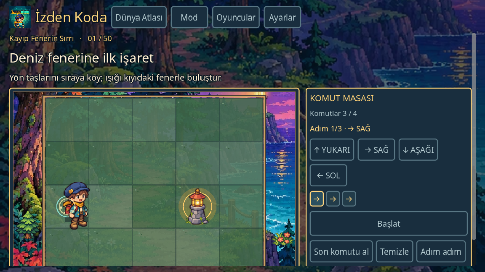
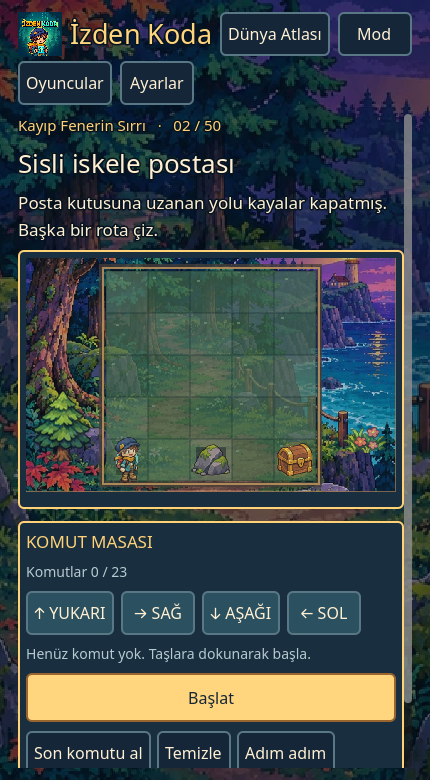
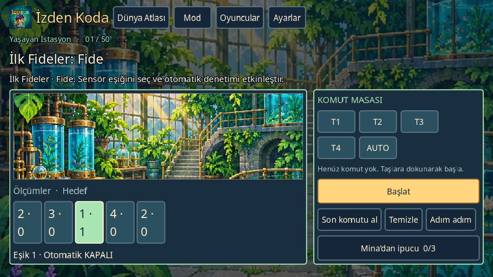

# İzden Koda

Yön komutlarını sırala, kâşifi kıyıdaki fenere ulaştır ve Denge Atlası’nın diğer dünyalarını keşfet. **Başlat** ile komutları sırayla izle. Yol kayaya çıkarsa sırayı değiştir ve yeniden dene. Açık uçlu rota görevlerinde hedefe ulaşan ve komut bütçesine uyan farklı yollar geçerlidir.

**7 dünya · 350 görev · 16 bulmaca türü**

Türkçe ve İngilizce oynanabilen, 2–8. sınıflara yönelik çevrimdışı bir piksel macera. Yön bulmadan örüntülere, döngülere ve koşullara doğru ilerler. Görevleri kontrol düğmeleriyle, sıralanabilir komut bloklarıyla veya görevlerin kod not defteriyle çözebilirsin. İlerleme cihazındaki oyuncu profilinde tutulur.

## Güncel sürümü indir

[v0.8.1 sürüm açıklaması ve dosya doğrulama bilgileri](https://github.com/sendagburak/izden-koda/releases/tag/v0.8.1)

| Platform | İndirme |
| --- | --- |
| Android ARM64 | [ARM64 APK](https://github.com/sendagburak/izden-koda/releases/download/v0.8.1/Izden_Koda_v0.8.1_Android_ARM64_Release.apk) |
| Android ARM32 | [ARM32 APK](https://github.com/sendagburak/izden-koda/releases/download/v0.8.1/Izden_Koda_v0.8.1_Android_ARM32_Release.apk) |
| Windows x64 | [Taşınabilir ZIP](https://github.com/sendagburak/izden-koda/releases/download/v0.8.1/Izden_Koda_v0.8.1_Windows_x64_Portable.zip) |
| Linux x64 | [Taşınabilir TAR.GZ](https://github.com/sendagburak/izden-koda/releases/download/v0.8.1/Izden_Koda_v0.8.1_Linux_x64_Portable.tar.gz) |
| Pardus amd64 | [DEB paketi](https://github.com/sendagburak/izden-koda/releases/download/v0.8.1/algoritma-oyunu_0.8.1_amd64.deb) |
| Godot kaynağı | [Godot kaynak ZIP](https://github.com/sendagburak/izden-koda/releases/download/v0.8.1/Izden_Koda_Godot_Kaynak_v0.8.1.zip) |

- **Android** için telefonuna uygun imzalı APK’yı aç. Çoğu güncel Android cihaz ARM64 kullanır. 32 bit Android için ARM32 dosyasını seç.
- **Windows** için ZIP’in tamamını çıkar ve `izden-koda.exe` dosyasını aç. `.pck` dosyasını aynı klasörde tut.
- **Linux** için TAR.GZ arşivini çıkar ve içindeki `.x86_64` çalıştırıcısını aç. `.pck` dosyasını aynı klasörde tut.
- **Pardus** için amd64 `.deb` dosyasını paket yöneticisiyle veya `sudo apt install ./algoritma-oyunu_0.8.1_amd64.deb` komutuyla kur.

## Oyundan ekranlar

*Kayıp Fenerin Sırrı. Komut dizisi oynarken kâşifin her adımı görünür.*

 

*Sisli İskele’nin dikey düzeni ve Yaşayan İstasyon dünyası. Görseller v0.8.1’in gerçek oyun ekranlarından alınmıştır.*

## Tüm sürümler

| Sürüm | Neler değişti? | Doğrudan indirme |
| --- | --- | --- |
| [v0.8.1](https://github.com/sendagburak/izden-koda/releases/tag/v0.8.1) | Kâşifli kare logo, açılış görseli ve uygulama simgeleri. | [APK 64](https://github.com/sendagburak/izden-koda/releases/download/v0.8.1/Izden_Koda_v0.8.1_Android_ARM64_Release.apk) · [APK 32](https://github.com/sendagburak/izden-koda/releases/download/v0.8.1/Izden_Koda_v0.8.1_Android_ARM32_Release.apk) · [Windows](https://github.com/sendagburak/izden-koda/releases/download/v0.8.1/Izden_Koda_v0.8.1_Windows_x64_Portable.zip) · [Linux](https://github.com/sendagburak/izden-koda/releases/download/v0.8.1/Izden_Koda_v0.8.1_Linux_x64_Portable.tar.gz) · [Pardus](https://github.com/sendagburak/izden-koda/releases/download/v0.8.1/algoritma-oyunu_0.8.1_amd64.deb) · [Kaynak](https://github.com/sendagburak/izden-koda/releases/download/v0.8.1/Izden_Koda_Godot_Kaynak_v0.8.1.zip) |
| [v0.8.0](https://github.com/sendagburak/izden-koda/releases/tag/v0.8.0) | Yeni piksel sahneler, komut oynatma efektleri ve alternatif rotalar. | [APK 64](https://github.com/sendagburak/izden-koda/releases/download/v0.8.0/Izden_Koda_v0.8.0_Android_ARM64_Release.apk) · [APK 32](https://github.com/sendagburak/izden-koda/releases/download/v0.8.0/Izden_Koda_v0.8.0_Android_ARM32_Release.apk) · [Windows](https://github.com/sendagburak/izden-koda/releases/download/v0.8.0/Izden_Koda_v0.8.0_Windows_x64_Portable.zip) · [Linux](https://github.com/sendagburak/izden-koda/releases/download/v0.8.0/Izden_Koda_v0.8.0_Linux_x64_Portable.tar.gz) · [Pardus](https://github.com/sendagburak/izden-koda/releases/download/v0.8.0/algoritma-oyunu_0.8.0_amd64.deb) · [Kaynak](https://github.com/sendagburak/izden-koda/releases/download/v0.8.0/Izden_Koda_Godot_Kaynak_v0.8.0.zip) |
| [v0.7.0](https://github.com/sendagburak/izden-koda/releases/tag/v0.7.0) | Godot’ta doğrulanan kampanya ve ilk kurulum paketleri. | [APK 64](https://github.com/sendagburak/izden-koda/releases/download/v0.7.0/Algoritma_Oyunu_v0.7.0_Android_arm64_Release.apk) · [APK 32](https://github.com/sendagburak/izden-koda/releases/download/v0.7.0/Algoritma_Oyunu_v0.7.0_Android_arm32_Release.apk) · [Windows](https://github.com/sendagburak/izden-koda/releases/download/v0.7.0/ALGORITMA_OYUNU_v0.7.0_Windows_x64_Portable.zip) · [Linux](https://github.com/sendagburak/izden-koda/releases/download/v0.7.0/ALGORITMA_OYUNU_v0.7.0_Linux_x64_Portable.tar.gz) · [Pardus](https://github.com/sendagburak/izden-koda/releases/download/v0.7.0/algoritma-oyunu_0.7.0_amd64.deb) · [Kaynak](https://github.com/sendagburak/izden-koda/releases/download/v0.7.0/ALGORITMA_OYUNU_Godot_Kaynak_v0.7.0.zip) |
| [v0.6](https://github.com/sendagburak/izden-koda/releases/tag/v0.6) | Profil geçişi, yedek geri yükleme ve ilerleme koruması. | [Kaynak](https://github.com/sendagburak/izden-koda/releases/download/v0.6/ALGORITMA_OYUNU_Godot_Kaynak_v0.6.zip) |
| [v0.5](https://github.com/sendagburak/izden-koda/releases/tag/v0.5) | Yedi dünyaya genişleyen kampanya, 16 bulmaca türü ve üç görev düzeyi. | [Kaynak](https://github.com/sendagburak/izden-koda/releases/download/v0.5/ALGORITMA_OYUNU_Godot_Kaynak_v0.5.zip) |
| [v0.1](https://github.com/sendagburak/izden-koda/releases/tag/v0.1) | İlk beş görev ve üç bulmaca türü. | [Kaynak](https://github.com/sendagburak/izden-koda/releases/download/v0.1/ALGORITMA_OYUNU_Dikey_Dilim_Kaynak_v0.1.zip) |

İlk üç sürüm Godot kaynak arşividir. v0.7.0 ve sonrasında kurulum paketleri de bulunur. Sürüm sayfalarında değişiklikler, oyun ekranı ve SHA-256 dosyası yer alır.

## Godot projesi

Proje Godot 4.7.2 Standard ve Compatibility çizicisiyle hazırlanmıştır. Geliştirme için kaynak arşivini çıkarıp `project.godot` dosyasını aç.

- [Derleme ve test adımları](BUILD.md)
- [Oyun tasarımı](docs/GDD.md)
- [Teknik mimari](docs/teknik-mimari.md)
- [Kullanılan varlıklar ve lisansları](LISANSLAR.md)
